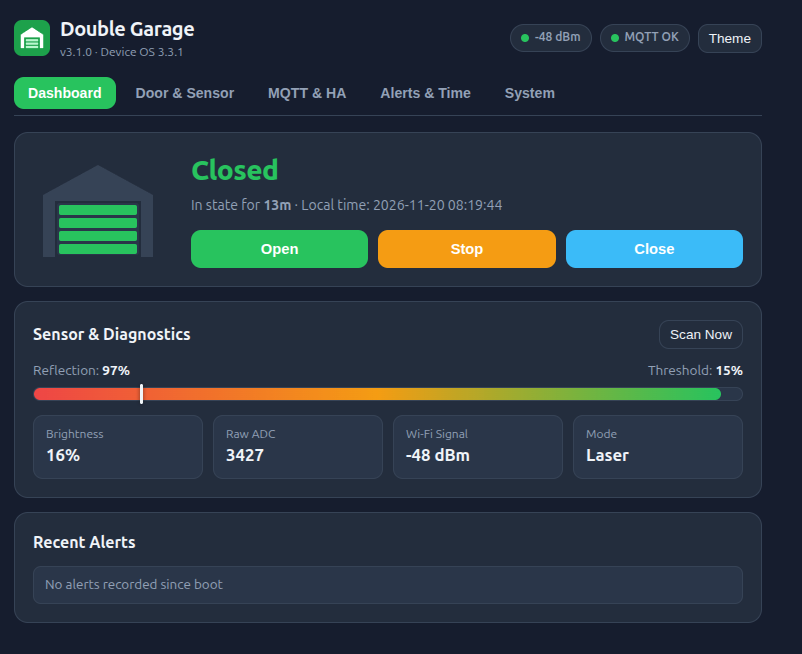

# Garadget Local Firmware

[](https://github.com/Krazy998/garadget-firmware/actions/workflows/build.yml)
[](https://github.com/Krazy998/garadget-firmware/releases)
[-00adef)](https://github.com/particle-iot/device-os/releases/tag/v3.3.1)
[](LICENSE)

A complete, **100% local and cloud-free** C++17 firmware rewrite for the **Garadget** garage door controller (Particle P1), running on **Particle Device OS 3.3.1** with a built-in Web UI, Home Assistant auto-discovery, MQTT, and wireless Local Web OTA updates.

<p align="center">
  
</p>

---

## Features

- **100% Cloudless** — Removes all Particle Cloud and Garadget Cloud dependencies. Runs purely on your local Wi-Fi network (supports DHCP or Static IP + custom DNS).
- **Built-in Modern Web UI** — Responsive dark/light dashboard hosted directly on the device (`http://<device-ip>/`) with live door animation, Open/Stop/Close buttons, real-time laser reflection meter, and full configuration.
- **Home Assistant Auto-Discovery & MQTT 3.1.1** — Automatically creates a **Garadget P1** device in Home Assistant (5-state garage cover, laser reflection, brightness, Wi-Fi signal, time in state, alerts, threshold slider, **Stealth Mode** LED switch, **LED Brightness** slider, and reboot button) while keeping backwards-compatible `garadget/<name>/...` MQTT topics.
- **Built-in Config Backup & Restore** — One-click JSON export/import of settings in the Web UI (**System** tab) plus RGB status LED dimming / Stealth Mode.
- **Wireless Local Web OTA** — Upload future `.bin` updates right from your browser or `make ota` with built-in P1 header and CRC32 validation.
- **Original Hardware & Logic Preserved** — Keeps Garadget's laser optical sensor (`D2`/`A0`), multi-click relay controller (`D3`), dry-contact switch option (`D0`, now runtime-selectable), SoftAP Wi-Fi setup (`192.168.0.1`), and local SNTP time/DST alerts — with safety fixes and a 60s hardware watchdog.

---

## Quick Install (USB — First Time Only)

You only need USB once to upgrade the P1 bootloader + Device OS to **3.3.1** and flash the initial firmware. All future updates can be uploaded wirelessly via **Local Web OTA**.

### 1. Install USB Flashing Tools (Ubuntu / Debian Example)

No Particle account or login is required — `particle flash --local` works completely offline over USB.

```bash
# Install dfu-util and curl
sudo apt update && sudo apt install -y dfu-util curl

# Install the Particle CLI (includes local USB/DFU flashing support)
bash <(curl -sL https://particle.io/install-cli)
export PATH="$HOME/bin:$PATH"   # or restart your terminal

# Configure Linux USB permissions (udev rules) for Particle P1
sudo particle usb configure
```

> **Note:** On macOS use `brew install dfu-util` + the same `particle.io/install-cli` command. On Windows use the [Particle CLI installer](https://binaries.particle.io/cli/installer/windows/ParticleCLIInstaller.exe). If you skip `particle usb configure` on Linux, just prefix the `particle flash` commands below with `sudo`.

### 2. Download the Release Binaries

Download all 4 `.bin` files from the latest [**GitHub Release**](https://github.com/Krazy998/garadget-firmware/releases) into a folder:
- `p1-bootloader@3.3.1+lto.bin`
- `p1-system-part1@3.3.1.bin`
- `p1-system-part2@3.3.1.bin`
- `garadget.bin`

### 3. Flash Bootloader, Device OS 3.3.1 & Firmware

Connect your Garadget with a **micro-USB data cable** (not a charge-only cable):

```bash
# Step A — Bootloader (required if upgrading from Device OS < 2.0)
# Hold the M button on Garadget for ~3s until the LED blinks DARK BLUE (Listening Mode), then run:
particle flash --local p1-bootloader@3.3.1+lto.bin

# Step B — Device OS 3.3.1 system parts + Garadget Local firmware
# particle flash --local automatically puts the P1 into DFU mode (blinking yellow) for each file:
particle flash --local p1-system-part1@3.3.1.bin
particle flash --local p1-system-part2@3.3.1.bin
particle flash --local garadget.bin
```

> **Troubleshooting:** If any command in Step B says no device was found, manually put the Garadget into **DFU Mode** (hold **`M`** + **`R`**, release **`R`**, keep holding **`M`** until the LED blinks **yellow**), then re-run that command.

---

## Setup & Usage

1. **Connect to Wi-Fi & Set Admin Password**: If no Wi-Fi or Web Admin Password is set (or hold **`M`** for 3s until the LED blinks **dark blue**), the device starts its `Photon-XXXX` setup hotspot. Open **`http://192.168.0.1/`** to configure your Wi-Fi, **Web Admin Password** (minimum 8 characters, required), and optional MQTT settings. You can also use Wi-Fi Setup Mode at any time to set or reset a forgotten Web Admin Password while keeping your existing Wi-Fi.
2. **Open the Web UI**: Find the device's IP in your router (or type `status` over USB serial at `115200` baud), visit **`http://<garadget-ip>/`**, and sign in with your Web Admin Password.
3. **Connect Home Assistant**: In the **MQTT & HA** tab, enter your broker host/IP and credentials. The device appears automatically under **Settings → Devices & Services → MQTT** with a direct **Visit** link to the Web UI.
4. **Calibrate**: Use the live **Reflection %** meter on the Dashboard to set **Reflection Threshold (`srt`)** between your open and closed readings, and match **Door Motion Time (`mtt`)** to your door's travel time.

---

## Security & Trust Model

- **Mandatory Admin Password (No LAN Claim Window)**: The device will not join the LAN with an empty Web Admin Password. If EEPROM is fresh, factory-reset, or corrupt, it automatically enters SoftAP setup mode (`192.168.0.1`). Passwords require at least **8 characters** and can only be initialized or reset via SoftAP (physical proximity) or USB Serial (`set apass=...`).
- **Admin Password = Full Code Execution**: Anyone who knows the Web Admin Password can upload and flash any valid Particle P1 firmware binary over **Local Web OTA** (`POST /api/ota`). The OTA validator verifies the P1 header, flash bounds, exact length, and IEEE 802.3 CRC32 (integrity against corruption/wrong platform), not cryptographic signatures. Treat the admin password with the same care as root/admin credentials.
- **Brute-Force & CSRF Protection**: `/api/*` endpoints enforce constant-time `X-Auth-Token` checks, same-origin + non-simple `Content-Type` CSRF checks, and per-IP exponential rate limiting (`15s → 30s → 60s → 120s → 300s` across 8 tracked IP slots with global spray fallback).
- **Scoped MQTT Access**: `garadget/<name>/set-config` over MQTT is limited to operational sensor, door timing, alert, timezone, and LED parameters — it cannot change `apass`, static IP/network settings, MQTT broker credentials, NTP server, or reset factory defaults.
- **Local LAN Transport**: Due to Particle P1 RAM limits, LAN HTTP (port 80) and MQTT (port 1883) run unencrypted on your local network. Keep the device on a trusted LAN/IoT VLAN and do not port-forward it to the internet.

---

## Wireless Updates (Local Web OTA)

- **Browser**: Open `http://<garadget-ip>/` → **System** tab → select `garadget.bin` → **Upload & Flash Firmware**.
- **Terminal**:
  ```bash
  make ota HOST=192.168.1.50 PASS=yourpassword
  ```

Updates stream into the P1's dedicated OTA staging slot and validate the Particle P1 platform ID, flash bounds, length, and IEEE 802.3 CRC32 before rebooting (and return `503` if a door relay click sequence is in progress).

---

## Reference & Developer Docs

<details>
<summary><strong>Building from Source & Local Toolchain Setup (Ubuntu / Linux, 100% Offline)</strong></summary>

This repository includes a self-contained offline toolchain installer (`scripts/setup-toolchain.sh`) that fetches **Particle Device OS v3.3.1**, the official P1 Device OS 3.3.1 `.bin` files (bootloader + system parts), and **GNU Arm Embedded Toolchain 10.2.1** into `.toolchain/` (gitignored) — no Particle Workbench or Particle Cloud login needed.

### 1. Install Ubuntu Build Prerequisites
```bash
sudo apt update && sudo apt install -y build-essential git curl python3 xxd dfu-util
```

### 2. Clone & Download the Local Particle Toolchain
```bash
git clone https://github.com/Krazy998/garadget-firmware.git
cd garadget-firmware

# Downloads Device OS 3.3.1 source, P1 OS 3.3.1 binaries, and GCC ARM 10.2.1 into .toolchain/
make toolchain
```

After `make toolchain` finishes, you'll have:
- `.toolchain/deviceOS/3.3.1/` — Particle Device OS 3.3.1 SDK & build system
- `.toolchain/gcc-arm/10.2.1/` — `arm-none-eabi-gcc` 10.2.1 cross-compiler
- `.toolchain/device-os-bins/3.3.1/` — `p1-bootloader@3.3.1+lto.bin`, `p1-system-part1@3.3.1.bin`, `p1-system-part2@3.3.1.bin`

### 3. Test & Compile
```bash
# Run native C++17 host unit tests
make test

# Embed gzipped Web UI & compile target/garadget.bin (~90 KB / 128 KB P1 user slot)
make firmware
```

### 4. Flash Directly from the Repo
```bash
# First-time OS upgrade + firmware flash via Particle CLI
particle flash --local .toolchain/device-os-bins/3.3.1/p1-bootloader@3.3.1+lto.bin
particle flash --local .toolchain/device-os-bins/3.3.1/p1-system-part1@3.3.1.bin
particle flash --local .toolchain/device-os-bins/3.3.1/p1-system-part2@3.3.1.bin
particle flash --local target/garadget.bin

# Or raw dfu-util (device in DFU blinking-yellow mode; bootloader still requires Listening Mode)
make flash-os
make flash
```

</details>

<details>
<summary><strong>MQTT Topics & Home Assistant Discovery</strong></summary>

Default topic root for Device Name `Garage`:

| Topic | Direction | Payload |
| --- | --- | --- |
| `garadget/Garage/LWT` | Publish (retained) | `Online` / `Offline` |
| `garadget/Garage/status` | Publish (retained) | `{"status":"closed","time":"5m","sensor":84,"bright":40,"signal":-58,"ip":"192.168.1.50"}` |
| `garadget/Garage/config` | Publish (retained) | JSON config (passwords redacted) |
| `garadget/Garage/alert` | Publish | `{"name":"Garage","type":"timeout","data":"20m"}` |
| `garadget/Garage/command` | Subscribe | `open`, `close`, `stop`, `toggle`, `get-status`, `get-config`, `reboot`, `refresh-discovery` |
| `garadget/Garage/set-config` | Subscribe | JSON or `key=val\|key=val` (operational sensor/alert/LED keys only; network/broker/NTP/password blocked) |
| `garadget/Garage/set-threshold` | Subscribe | Integer `1`–`80` |
| `garadget/Garage/set-stealth` | Subscribe | `ON` / `OFF` (Home Assistant Stealth Mode switch) |
| `garadget/Garage/set-led-brightness` | Subscribe | Integer `0`–`100` (Home Assistant LED Brightness slider) |
| `homeassistant/status` | Subscribe | Re-publishes discovery on HA `online` birth message |

**Auto-discovered Home Assistant entities:** Garage Door (`cover`), Reflection (`sensor`), Ambient Brightness (`sensor`), Wi-Fi Signal (`sensor`), Time in State (`sensor`), Last Alert (`sensor`), Sensor Threshold (`number`), Stealth Mode (`switch`), LED Brightness (`number`), and Reboot (`button`).

</details>

<details>
<summary><strong>Local REST API & USB Serial CLI</strong></summary>

### REST API (`http://<garadget-ip>`)
All `/api/*` endpoints require a configured Web Admin Password (`apass`, min 8 chars, initialized via SoftAP or USB Serial) and header `X-Auth-Token: <password>`.

| Method & Path | Description |
| --- | --- |
| `GET /` | Gzipped Web UI dashboard |
| `GET /api/status` | Live door state, sensor readings, network, MQTT, NTP, memory & alert history |
| `GET /api/config` | Current configuration JSON (passwords masked as boolean flags) |
| `POST /api/config` | Update configuration parameters (JSON body) |
| `POST /api/command` | Execute door command: `{"command":"open\|close\|stop\|toggle"}` |
| `POST /api/system` | Execute action: `{"action":"scan\|sync-time\|ha-rediscover\|wifi-setup\|clear-wifi\|reboot\|factory-reset"}` |
| `POST /api/ota` | Stream raw `garadget.bin` (`application/octet-stream`) for validated local OTA flash (`503` if relay busy) |

### USB Serial CLI (`115200` baud)
`help` · `status` · `config` · `set key=val|k=v` · `open` · `close` · `stop` · `toggle` · `scan` · `wifi-setup` · `reboot` · `factory-reset`

</details>

<details>
<summary><strong>Hardware Pinout & Physical Button</strong></summary>

| Pin | Function |
| --- | --- |
| `D2` | Laser emitter (1 ms pulse during optical scan) |
| `A0` | Phototransistor analog input (12-bit ADC) |
| `D3` | Relay driver (forced `LOW` on boot) |
| `D0` | Optional dry-contact reed/limit switch (`INPUT_PULLUP` in Switch NO/NC mode) |
| `M` button | Hold **3s** = SoftAP Wi-Fi Setup (`192.168.0.1`) · Hold **10s** = Factory Reset |

</details>

<details>
<summary><strong>Key Reliability & Safety Improvements Over Original v1.26</strong></summary>

- `SYSTEM_MODE(MANUAL)` + `SYSTEM_THREAD(ENABLED)` + 60s `ApplicationWatchdog` so network hiccups never stall door sensing or relay timing.
- Local UDP SNTP client (`pool.ntp.org` by default, or any LAN NTP IP) replaces Particle Cloud time sync, with fixed Southern Hemisphere DST support.
- Signed, clamped laser reflection math fixes unsigned underflow in bright sunlight and honors configurable sample averaging (`srr`).
- Zero-heap static-buffer MQTT 3.1.1 client with non-blocking incremental parser (fixes memory leaks and socket-hang lockups) and DNS hostname support.
- IEEE 802.3 CRC32-verified EEPROM config with schema versioning and redacted secrets in JSON responses.

</details>

---

## Credits & License

- **Changelog**: See [CHANGELOG.md](CHANGELOG.md) for full release history.
- **Original Project**: Based on the [Garadget](https://github.com/Garadget/firmware) project by Denis Grisak. This is an independent, unofficial, cloud-free rewrite.
- **AI-Assisted Rewrite**: This modern cloud-free rewrite was authored with **Gemini 4 Neon AI** to keep existing Garadget hardware alive with long-term local support for users still running these devices.
- **SoftAP RSA**: Uses Tom Wu's BSD-licensed `jsbn` RSA library (`web/softap/rsa-utils/`) for Particle P1 SoftAP credential encryption.
- **License**: GNU General Public License v3.0 — see [LICENSE](LICENSE).
